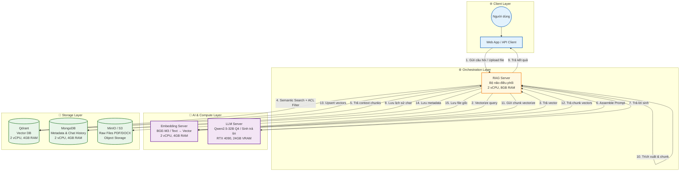

Cấu hình cơ bản để doanh nghiệp của bạn có AI khai thác tri thức
Một hệ thống RAG (Retrieval-Augmented Generation) hoàn chỉnh không phải là một ứng dụng đơn lẻ mà là sự kết hợp của nhiều thành phần chuyên biệt, mỗi thành phần đảm nhận một vai trò riêng biệt trong toàn bộ vòng đời xử lý tri thức. Dưới đây là kiến trúc tối thiểu mà AgentBook khuyến nghị để một doanh nghiệp có thể triển khai hệ thống AI khai thác tài liệu nội bộ một cách ổn định và hiệu quả.

—

1. RAG Server: Bộ não điều phối toàn bộ hệ thống
   Cấu hình: 2 vCPUs, 8 GB Memory
   RAG Server là thành phần trung tâm, chịu trách nhiệm điều phối toàn bộ luồng xử lý từ lúc người dùng đặt câu hỏi đến khi nhận được câu trả lời. Khi một truy vấn được gửi lên, RAG Server thực hiện tuần tự các bước: gọi Embedding Server để vector hóa câu hỏi, truy vấn Qdrant để tìm các đoạn tài liệu liên quan nhất, tổng hợp ngữ cảnh, rồi gọi LLM Server để sinh ra câu trả lời cuối cùng.
   Ngoài việc xử lý câu hỏi theo thời gian thực, RAG Server còn quản lý pipeline ingestion tài liệu: nhận file từ người dùng, chia nhỏ thành các chunk, gọi Embedding Server để tạo vector, và lưu cả vector lẫn metadata vào đúng nơi lưu trữ tương ứng.
   RAM 8 GB được cấp cao hơn các server khác vì RAG Server phải giữ nhiều context đồng thời, đặc biệt khi xử lý song song nhiều phiên chat hoặc nhiều tài liệu cùng lúc.
   —
2. Qdrant Server: Bộ nhớ ngữ nghĩa của hệ thống
   Cấu hình: 2 vCPUs, 4 GB Memory
   Qdrant là một vector database chuyên dụng, đóng vai trò như "bộ nhớ ngữ nghĩa" của toàn hệ thống. Thay vì tìm kiếm từ khóa theo kiểu truyền thống, Qdrant lưu trữ các vector embedding của từng đoạn tài liệu và cho phép tìm kiếm theo độ tương đồng ngữ nghĩa (semantic similarity).
   Khi người dùng hỏi "chính sách bảo hành sản phẩm là gì", Qdrant không tìm đúng từ "bảo hành" mà hiểu được ý nghĩa của câu hỏi và trả về những đoạn văn bản có nội dung liên quan nhất, dù chúng có thể dùng từ ngữ hoàn toàn khác. Đây là yếu tố cốt lõi tạo nên sự khác biệt của RAG so với công cụ tìm kiếm thông thường.
   Qdrant cũng hỗ trợ filtering theo metadata (theo phòng ban, theo loại tài liệu, theo thời gian), giúp doanh nghiệp kiểm soát chính xác phạm vi tri thức mà mỗi người dùng được phép truy cập.
   —
3. MongoDB Server + MinIO: Lớp lưu trữ dữ liệu toàn diện
   Cấu hình: 2 vCPUs, 4 GB Memory
   Đây là cặp đôi đảm nhận toàn bộ việc lưu trữ dữ liệu phi vector của hệ thống, bao gồm hai loại dữ liệu có tính chất rất khác nhau.
   MongoDB lưu trữ dữ liệu có cấu trúc dạng document: thông tin người dùng, lịch sử cuộc trò chuyện, metadata của tài liệu (tên file, người upload, ngày tạo, quyền truy cập), cấu hình workspace và notebook. Mỗi khi người dùng quay lại xem lịch sử chat hoặc hệ thống cần kiểm tra quyền ACL trước khi trả lời, MongoDB là nơi được truy vấn đầu tiên.
   MinIO đóng vai trò là object storage tương thích S3, chuyên lưu trữ file thô: PDF, Word, Excel, hình ảnh và mọi loại tài liệu mà doanh nghiệp upload lên hệ thống. MinIO đảm bảo rằng file gốc luôn được lưu trữ an toàn và có thể truy xuất lại bất cứ lúc nào, độc lập với quá trình xử lý vector.
   Hai thành phần này hoạt động song song và bổ sung cho nhau: MinIO giữ file gốc, MongoDB giữ metadata và trạng thái, Qdrant giữ biểu diễn ngữ nghĩa của nội dung.
   —
4. Embedding Server: Cầu nối giữa ngôn ngữ và toán học
   Cấu hình: 2 vCPUs, 4 GB Memory
   Embedding Server chạy mô hình embedding (thường là BGE-M3 hoặc tương đương) với nhiệm vụ duy nhất nhưng cực kỳ quan trọng: chuyển đổi văn bản thành vector số học để máy tính có thể tính toán sự tương đồng giữa các đoạn văn bản.
   Server này được gọi ở hai thời điểm khác nhau trong luồng hoạt động. Thứ nhất là lúc ingestion tài liệu: mỗi chunk văn bản được chuyển thành vector và lưu vào Qdrant. Thứ hai là lúc người dùng đặt câu hỏi: câu hỏi cũng được vector hóa bằng cùng mô hình để đảm bảo tính nhất quán trong không gian vector khi so sánh.
   Tách Embedding Server thành một dịch vụ riêng biệt giúp hệ thống dễ dàng nâng cấp mô hình embedding mà không ảnh hưởng đến các thành phần khác, đồng thời cho phép scale độc lập khi khối lượng tài liệu tăng lên.
   —
5. LLM Server: Trái tim tạo sinh ngôn ngữ
   Cấu hình: RTX 4090, 24 GB VRAM
   LLM Server là thành phần duy nhất yêu cầu GPU, và đây là lý do tại sao on-premise RAG cần đầu tư phần cứng đặc biệt. Server này chạy mô hình ngôn ngữ lớn (có thể là Qwen2.5-32B, DeepSeek-R1-32B hoặc tương đương ở lượng tử hóa Q4) và chịu trách nhiệm sinh ra câu trả lời cuối cùng.
   Điểm quan trọng cần hiểu là LLM Server không tự "biết" tài liệu của doanh nghiệp. Nó chỉ nhận vào một prompt được RAG Server chuẩn bị sẵn, bao gồm câu hỏi của người dùng và các đoạn tài liệu liên quan được truy xuất từ Qdrant, rồi tổng hợp thành câu trả lời mạch lạc bằng ngôn ngữ tự nhiên.
   Với RTX 4090 24 GB VRAM, hệ thống có thể chạy các mô hình từ 14B đến 32B tham số ở chế độ Q4, đủ để xử lý tiếng Việt tốt và phù hợp với hầu hết nhu cầu của doanh nghiệp vừa và nhỏ mà không phụ thuộc vào API bên ngoài.
   —
   Tổng quan kiến trúc
   Năm thành phần trên hoạt động như một dây chuyền liên kết chặt chẽ. Tài liệu đi vào qua RAG Server, được vector hóa bởi Embedding Server, file gốc lưu trong MinIO, metadata lưu trong MongoDB, vector lưu trong Qdrant. Câu hỏi đến cũng qua RAG Server, được xử lý ngữ nghĩa nhờ Embedding và Qdrant, rồi LLM Server tổng hợp câu trả lời dựa trên tri thức thực của doanh nghiệp.
   Toàn bộ hệ thống này có thể chạy hoàn toàn on-premise, không có dữ liệu nào rời khỏi hạ tầng nội bộ, đáp ứng yêu cầu bảo mật nghiêm ngặt của các tổ chức tài chính, y tế và pháp lý.
